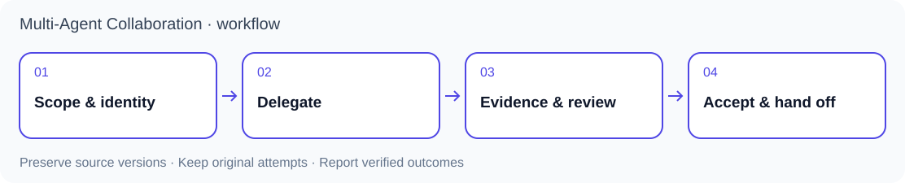

<p align="center"></p>

# Multi-Agent Collaboration

[繁體中文](README.zh-TW.md) · [Agent quickstart](docs/agent-quickstart.md) · [Skill contract](SKILL.md) · [Version history](CHANGELOG.md)

Coordinate existing Codex and Claude Code sessions with bounded assignments, traceable handoffs and independent review. Keep each agent's context and distinguish sending a task, receiving it, producing a result and accepting that result.

This repository provides collaboration rules, task records and local helpers. Agent subscriptions, model credentials and the terminal applications are separate dependencies.

## Choose the right layer

| Repository | Responsibility |
|---|---|
| **This project** | Agent identity, task ownership, communication, handoffs and review boundaries |
| [Thesis Refiner](https://github.com/lzhs1995/thesis-refiner) | Research questions, source-grounded NotebookLM review and local adjudication |
| [Office Word Revision](https://github.com/lzhs1995/officecli-word-revision) | DOCX editing, Word rendering, Zotero fields and document verification |



The supervisor owns scope and acceptance. Executors own separate deliverables. Use independent reviewers for named questions, record unresolved claims, and carry forward accepted work. Parallel file analysis is useful; shared application writes still require their resource contract.

## Published versions and transports

| Version lane | What it contains | How to use it |
|---|---|---|
| `main` / 0.4.79 | macOS cmux transport, Codex/Claude integration, evidence and recovery helpers | Use the commands below |
| [Herdr development lane](https://github.com/lzhs1995/multi-agent-collaboration/tree/feature/nested-research-skills-s40-20261104) | Shared contract, Herdr within a terminal, cmux across terminals, chapter-team coordination | Read that branch's SKILL and its profile before starting a new task |

The Herdr integration is not yet included in this default branch. Follow [PR #110](https://github.com/lzhs1995/multi-agent-collaboration/pull/110) and [PR #111](https://github.com/lzhs1995/multi-agent-collaboration/pull/111) for integration status. An existing task keeps its registered version, controller and original attempts even when its terminal moves.

## Start with an inspection

Live transport requires macOS, cmux, Python 3.10+ and existing CLI sessions. These commands clone and inspect the package; they do not send an agent a task or install hooks:

```sh
git clone https://github.com/lzhs1995/multi-agent-collaboration.git
cd multi-agent-collaboration
git rev-parse HEAD
python3 scripts/manage_install.py install
python3 scripts/mac_harness.py --help
```

Record the full `git rev-parse HEAD` output with the task. For a reproducible runtime baseline, use `git checkout --detach d1f78482909fe9828b854e42e66651b932449156` (0.4.79; predates this documentation/fixture cleanup). Do not upgrade an active controller implicitly.

`install` defaults to a dry run. Read [SKILL.md](SKILL.md), confirm the existing executor and inspect the proposed changes. When you intend to install:

```sh
python3 scripts/manage_install.py install --apply
python3 scripts/manage_install.py doctor
```

The installer links this checkout into supported clients and merges project-owned hooks. Keep that checkout in place. Existing shared installations require the documented immutable-release and upgrade process; this basic installer is not a whole-installation transaction. `doctor` checks configuration and benign hook execution, not live receipt or active-client loading.

For the first assignment, tell the supervisor the goal, designated existing executor, allowed files and acceptance criteria. Both participants read the same skill. Do not reset a session to solve a communication failure. Reconcile uncertain input before sending again.

## Other agents and platforms

Any agent able to read Markdown can start at [AGENTS.md](AGENTS.md) and follow the contract manually. [CLAUDE.md](CLAUDE.md) and [GEMINI.md](GEMINI.md) are thin navigation files. Their presence does not prove a client automatically loaded them. Packaged live integration targets Codex/Claude on macOS cmux; Linux is an offline-test target. This release does not provide Windows/tmux/ACP transport or certify every CLI agent. See [agent quickstart](docs/agent-quickstart.md).

## Verify and maintain

```sh
python3 scripts/test_all.py
```

Tests use isolated files and mocked terminals. They do not send live prompts. Test success, notification receipt, body reading, business acceptance and resource release are different facts.

[Operational history](docs/MAINTENANCE-NOTES.md) · [Delivery contract](references/verified-compose-delivery.md) · [Lessons](references/lessons.md) · [Security](SECURITY.md)

## Public data and license

Use synthetic tasks and terminal fixtures in public changes. Keep credentials, native conversation logs, research files and installation backups private. The current-tree scan and fixture cleanup do not certify all Git history, issues or external copies as sanitized.

Code and original [SVG artwork](assets/README.md) use the [MIT license](LICENSE). cmux, Herdr, Codex and Claude Code are separate products; the illustrations are this project's own marks.
