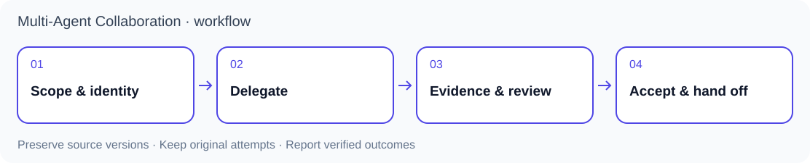

<p align="center"></p>

# 多 Agent 協作

[English](README.md) · [Agent 入門](docs/agent-quickstart.md) · [技能契約](SKILL.md) · [版本紀錄](CHANGELOG.md)

讓既有 Codex 與 Claude Code 會話以明確分工、可追溯交接及獨立審查共同完成任務。保留各自上下文，分別記錄「已送出」「已收到」「已產出」與「已驗收」，避免把終端活動當成工作完成。

本專案提供協作規則、任務紀錄與本機輔助程式。模型訂閱、憑證及終端應用需自行備妥。

## 三個專案如何配合

| 專案 | 負責內容 |
|---|---|
| **多 Agent 協作** | 身分綁定、任務權責、通訊、交接及審查邊界 |
| [論文精煉助手](https://github.com/lzhs1995/thesis-refiner) | 研究問題、NotebookLM 來源審查與本地逐條裁定 |
| [Word 論文修訂工具](https://github.com/lzhs1995/officecli-word-revision) | DOCX 修改、Word 原生排版、Zotero 欄位及文件驗證 |



主管負責範圍與驗收，執行者各自負責獨立產物。針對具名問題安排互核，記錄未決事項並沿用已驗收成果。檔案分析可並行；共用應用的寫入仍須遵守原資源契約。

## 版本與協作環境

| 分支 | 內容 | 使用方式 |
|---|---|---|
| `main`／0.4.79 | macOS cmux 通訊、Codex／Claude 整合與證據恢復工具 | 使用下列指令 |
| [Herdr 開發分支](https://github.com/lzhs1995/multi-agent-collaboration/tree/feature/nested-research-skills-s40-20261104) | 共同契約、Herdr 終端內協作、cmux 跨終端協調與章節團隊 | 新任務先讀該分支的 SKILL 及對應 profile |

Herdr 整合尚未納入預設分支；狀態見 [PR #110](https://github.com/lzhs1995/multi-agent-collaboration/pull/110) 與 [PR #111](https://github.com/lzhs1995/multi-agent-collaboration/pull/111)。既有任務保留原版本、控制器及原嘗試；移動終端不會自動遷移任務。

## 先檢查，再安裝

原生通訊需要 macOS、cmux、Python 3.10+ 與已存在的 CLI 會話。以下步驟只下載並檢查套件，不派發任務、不安裝 hook：

```sh
git clone https://github.com/lzhs1995/multi-agent-collaboration.git
cd multi-agent-collaboration
git rev-parse HEAD
python3 scripts/manage_install.py install
python3 scripts/mac_harness.py --help
```

將 `git rev-parse HEAD` 的完整結果記入任務。要復現固定執行基線，可執行 `git checkout --detach d1f78482909fe9828b854e42e66651b932449156`（0.4.79，早於本次文件與測試資料清理）；不要暗中升級執行中的控制器。

`install` 預設為預演。先讀 [SKILL.md](SKILL.md)，確認原執行者與預計修改；確定要安裝時執行：

```sh
python3 scripts/manage_install.py install --apply
python3 scripts/manage_install.py doctor
```

安裝器將本工作目錄連結至支援的客戶端，合併本專案擁有的 hook，因此須保留此目錄。已有共用安裝時須沿完整固定版本與升級流程；基本安裝器不是全安裝原子交易。`doctor` 只檢查設定與無害 hook 執行，不能證明執行中的客戶端已載入，亦不能證明真實任務已收到。

首次任務應告訴主管：目標、指定既有執行者、允許修改的檔案及驗收條件。雙方讀取同一技能。不要為通訊失敗清空會話；輸入結果不明時先核回原次，再決定後續。

## 其他 Agent 與平台

能讀 Markdown 的 Agent 可從 [AGENTS.md](AGENTS.md) 開始手動遵循契約。[CLAUDE.md](CLAUDE.md) 與 [GEMINI.md](GEMINI.md) 僅轉接入口；檔案存在不代表所有客戶端自動載入。現成原生整合以 macOS cmux 上的 Codex／Claude 為主；Linux 用於離線測試。此版沒有 Windows／tmux／ACP 通訊實作，也未認證所有 Agent。詳見 [Agent 入門](docs/agent-quickstart.md)。

## 驗證與維護

```sh
python3 scripts/test_all.py
```

測試使用隔離檔案及模擬終端，不發送真實提示。測試成功、通知送達、正文讀取、業務驗收與資源歸還須分別記錄。

[維護歷史](docs/MAINTENANCE-NOTES.md) · [交付契約](references/verified-compose-delivery.md) · [經驗](references/lessons.md) · [安全說明](SECURITY.md)

## 公開資料與授權

公開修改使用合成任務與終端測試資料。憑證、原生會話、研究原件及安裝備份保持私有。本次工作樹掃描與測試資料清理不代表所有 Git 歷史、討論及外部副本已完成脫敏。

程式與原創 [SVG 圖像](assets/README.md) 採 [MIT 授權](LICENSE)。cmux、Herdr、Codex 與 Claude Code 是獨立產品，圖像為本專案原創標誌。
